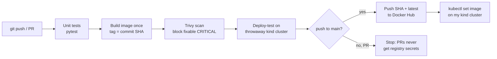

# End-to-End DevOps Pipeline: GitHub Actions → Docker → Kubernetes

A small Flask service shipped through a security-gated CI/CD pipeline. Every commit is unit-tested, built **once** into an image tagged with its commit SHA, scanned for vulnerabilities, deployed to a throwaway Kubernetes cluster and smoke-tested, and only then pushed to Docker Hub. Runs entirely on free tooling (GitHub Actions, Docker Hub, kind).

> Started from [rufilboss/devops-e2e-pipeline](https://github.com/rufilboss/devops-e2e-pipeline) (MIT). My changes are listed under [What I built on top](#what-i-built-on-top).

## Pipeline



| Stage | What it proves | Fails the pipeline when |
|---|---|---|
| Unit tests | Endpoints behave (`/`, `/health`, `/ready`, 404) | any test fails |
| Build | Image builds reproducibly (pinned deps + base digest) | build error |
| Trivy scan | No known, fixable CRITICAL CVEs in OS or Python packages | a fixable CRITICAL exists |
| Deploy-test (kind) | The real manifests start, pass probes and serve **this** commit | rollout times out or `/` reports a different version |
| Push | Same tested image goes to the registry | — (main branch only) |

## What I built on top

- **Test-gated pipeline**: `pytest` suite; the build job `needs:` the test job.
- **Immutable image tags**: commit SHA tag (plus `latest` for convenience); the SHA is baked into the image and returned by `GET /`, so you can prove what is running.
- **Build once, ship what you tested**: image is loaded locally, scanned and deploy-tested, then that exact image is pushed.
- **Supply-chain hardening**: every action pinned to a full commit SHA, base image pinned by digest, all Python deps pinned, Dependabot keeps pins fresh, workflow token is read-only, PRs never see Docker Hub secrets.
- **Real multi-stage Dockerfile** with Gunicorn (production WSGI server) instead of Flask's dev server, fixed non-root UID, exec-form CMD for clean SIGTERM handling.
- **Hardened Kubernetes manifests**: non-root, read-only root filesystem, all Linux capabilities dropped, seccomp `RuntimeDefault`, no service-account token, zero-downtime rolling update (`maxUnavailable: 0`), PodDisruptionBudget, resource requests/limits sized from measured memory.

## Run it locally

```bash
# Build and run the container
docker build --build-arg APP_VERSION=local -t demo-app:local ./app
docker run --rm -p 8080:8080 demo-app:local
curl localhost:8080/        # {"env":"dev","service":"demo-app","status":"ok","version":"local"}

# Run the tests in a throwaway container
docker run --rm -v "$PWD/app":/app -w /app python:3.12-slim \
  sh -c "pip install -q -r requirements-dev.txt && python -m pytest -v -p no:cacheprovider"

# Deploy to a local kind cluster using the image CI pushed for the current commit
kind create cluster --name demo
kubectl apply -f k8s/namespace.yaml   # namespace first; `apply -f k8s/` goes alphabetically
kubectl apply -f k8s/
kubectl set image deployment/demo-app app=beingmalik/demo-app:$(git rev-parse --short=7 HEAD) -n demo-app
kubectl rollout status deployment/demo-app -n demo-app
kubectl port-forward -n demo-app svc/demo-app 8080:80
```

## Layout

```
app/
  main.py               Flask app: /, /health (liveness), /ready (readiness)
  test_main.py          pytest suite
  Dockerfile            multi-stage, gunicorn, non-root UID 10001
  requirements.txt      pinned runtime deps
  requirements-dev.txt  test deps
k8s/
  namespace.yaml
  deployment.yaml       Deployment + PodDisruptionBudget
  service.yaml          ClusterIP Service (80 -> 8080)
terraform/              Kubernetes provider example (namespace)
.github/
  workflows/ci-cd.yaml  the pipeline
  dependabot.yml        weekly updates for actions, base image, pip
```

Secrets required in the repo: `DOCKERHUB_USERNAME`, `DOCKERHUB_TOKEN` (a Docker Hub access token, not the password).

## Roadmap

- **GitOps CD**: Argo CD in the cluster watches this repo; CI commits the new image tag and Argo CD syncs it (pull-based, no cluster credentials in CI).
- **Image signing and SBOM**: sign with cosign (keyless, GitHub OIDC), attach an SBOM, verify signatures at admission.
- **Cloud target**: Terraform for an EKS cluster, with GitHub → AWS auth via OIDC instead of long-lived keys.
- **Observability**: Prometheus metrics endpoint, HPA on CPU/RPS, structured JSON logs.

## License

[MIT](LICENSE)
